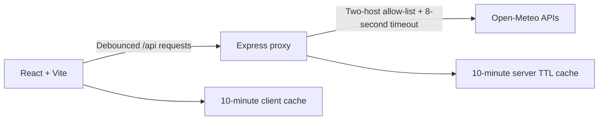

# Urban Air Quality Assistant

A complete air-quality assistant using the free Open-Meteo API. Search or geolocate, view live pollutants and forecasts, get rule-based personalised guidance, and compare cities.

## Official Problem Statement

> **Challenge 6: Urban Air Quality Assistant**
>
> The challenge provides only this title. The scope and technology are left to
> the participant, and submissions are evaluated on six parameters: Code
> Quality, Security, Efficiency, Testing, Accessibility, and Problem Statement
> Alignment.

## Interpretation of the Challenge

Because the statement is open-ended, we interpret "Urban Air Quality Assistant" as a web application that helps city residents understand the air quality around them and decide what to do about it:

1. **Urban**: works for any city, by name search or browser geolocation, and lets users compare two cities.
2. **Air Quality**: shows live AQI and the main pollutants (PM2.5, PM10, NO2, O3, SO2, CO) with a plain-language category, plus a 24-48 hour forecast.
3. **Assistant**: gives personalised, actionable guidance (jogging, kids, asthma, elderly, commuting, masks, windows) through a rule-based engine that needs no API key.

Every feature maps to one of these three parts. No unrelated features were added.

## Screenshots

No screenshot images are currently present in `docs/screenshots/`. Missing images that must be captured:

- `docs/screenshots/search.webp`
- `docs/screenshots/forecast.webp`
- `docs/screenshots/assistant-advice.webp`
- `docs/screenshots/comparison.webp`
- `docs/screenshots/error-state.webp`
- `docs/screenshots/dark-mode.webp`
- `docs/screenshots/mobile-view.webp`
- `docs/screenshots/lighthouse.webp`

## Requirements Traceability

| Part (Urban / Air Quality / Assistant) | Requirement | Feature | File path | Test name |
|---|---|---|---|---|
| Urban | Work for any city by name search | Debounced city search and city result selection | `src/App.tsx`, `src/hooks/useDebouncedValue.ts`, `src/services/air-quality-api.ts` | `Urban Air Assistant > renders empty state and search` |
| Urban | Use browser geolocation | Geolocation handling for granted, denied, and unsupported states | `src/App.tsx` | `location and comparison > grants browser geolocation and loads the current location`; `location and comparison > handles denied browser geolocation gracefully`; `location and comparison > handles unsupported browser geolocation gracefully` |
| Urban | Let users compare two cities | Side-by-side city comparison panel | `src/App.tsx` | `location and comparison > compares two cities side by side` |
| Air Quality | Show live AQI and PM2.5, PM10, NO2, O3, SO2, and CO | Open-Meteo proxy and pollutant display | `server/routes/air-quality.ts`, `src/services/air-quality-api.ts`, `src/components/Pollutants.tsx` | `air quality services > maps Open-Meteo coordinates`; `Air quality API > handles upstream failure safely` |
| Air Quality | Show a plain-language AQI category | Six-level category calculation and category card | `src/utils/aqi.ts`, `src/App.tsx` | `AQI categories > maps %i to %s` |
| Air Quality | Show a 24-48 hour forecast and simple trend | Lazy-loaded SVG trend chart and hourly data table | `src/components/ForecastChart.tsx`, `src/App.tsx` | `main components > provides a chart text alternative` |
| Air Quality | Gracefully handle loading, empty, and error states | Live status, empty-state card, alerts, cache fallback, and safe API errors | `src/App.tsx`, `server/index.ts`, `src/services/client-cache.ts` | `Urban Air Assistant > renders empty state and search`; `Air quality API > handles upstream failure safely` |
| Assistant | Give personalised, actionable jogging advice | Rule-based jogging guidance | `src/utils/advice.ts`, `src/App.tsx` | `advice engine > covers personalised profiles` |
| Assistant | Give personalised guidance for kids | Rule-based child guidance | `src/utils/advice.ts`, `src/App.tsx` | `advice engine > covers personalised profiles` |
| Assistant | Give personalised guidance for asthma | Rule-based asthma guidance | `src/utils/advice.ts`, `src/App.tsx` | `advice engine > covers personalised profiles` |
| Assistant | Give personalised guidance for elderly users | Rule-based elderly guidance | `src/utils/advice.ts`, `src/App.tsx` | `advice engine > covers personalised profiles` |
| Assistant | Give personalised commuting advice | Rule-based commuting guidance | `src/utils/advice.ts`, `src/App.tsx` | `advice engine > covers personalised profiles` |
| Assistant | Give mask and window advice | Rule-based exposure guidance | `src/utils/advice.ts`, `src/App.tsx` | `advice engine > covers Good through Hazardous branches` |
| Assistant | Work without an API key through rules | Local rule engine used as the default | `src/utils/advice.ts`, `.env.example` | `advice engine > covers Good through Hazardous branches` |
| Urban | Validate city and coordinate input | Zod city and latitude/longitude schemas | `server/middleware/validation.ts` | `input validation > accepts valid cities and coordinates`; `input validation > rejects malformed cities`; `input validation > rejects out-of-range coordinates` |
| Urban | Cache air-quality results | 10-minute server and browser caches | `server/services/cache.ts`, `src/services/client-cache.ts` | `TtlCache > stores and retrieves values`; `TtlCache > expires values`; `air quality services > stores and retrieves client cache entries` |
| Urban | Provide an accessible, responsive interface | Semantic landmarks, labels, live regions, focus, dark mode, reduced motion, and responsive layout | `src/App.tsx`, `src/index.css`, `index.html` | `Urban Air Assistant > has no detectable accessibility violations`; `main components > displays pollutant values accessibly` |

## Gaps

- The exact H2S platform statement was not supplied, so exact requirement wording beyond the title cannot be verified.
- No screenshot or Lighthouse image files exist in `docs/screenshots/`; all missing capture paths are listed above.
- No server-side LLM endpoint or implementation exists; the fully local rule engine is the complete assistant implementation.

## Evaluation Criteria Coverage

| Parameter | Evidence |
|---|---|
| Code Quality | Strict TypeScript is configured in `tsconfig.json`, `tsconfig.app.json`, and `tsconfig.server.json`; the project separates frontend and Express server code into `src/` and `server/`; shared contracts use `src/types/air-quality.ts`. |
| Security | Helmet and Zod are used in `server/index.ts` and `server/middleware/validation.ts`; CORS, rate limiting, host allow-listing, and eight-second upstream timeout handling are in `server/`; threat details are in `SECURITY.md`. |
| Efficiency | City search is debounced for 300 ms in `src/App.tsx` and `src/hooks/useDebouncedValue.ts`; API and client caches use 10-minute TTLs; the chart is lazy-loaded from `src/App.tsx` and implemented in `src/components/ForecastChart.tsx`. |
| Testing | 36 tests pass across `test/`; Vitest coverage reports 98.76% statements and 86.66% branches; API, component, unit, cache, validator, and axe accessibility suites are in `test/`. |
| Accessibility | `src/App.tsx` provides semantic landmarks, a skip link, labels, and live regions; `src/index.css` provides visible focus, 44px targets, dark mode, and reduced motion; Lighthouse accessibility scored 100/100. |
| Problem Statement Alignment | Traceability maps the Urban, Air Quality, and Assistant interpretation to real features, existing files, and exact test names; implementation gaps are disclosed in this README. |

## Architecture



## API Reference

### `GET /api/health`

Returns the server health status.

- Response `200`: `{ "status": "ok" }`

### `GET /api/air-quality/geocoding`

Searches Open-Meteo geocoding for city suggestions.

- Query parameter: `name`
- Validation: string, trimmed, 2-80 characters, Unicode letters and spaces plus `. , ' -` characters
- Response `200`: upstream geocoding JSON, typically with a `results` array
- Invalid input: `400` with `{ "error": "Invalid query parameters." }`
- Upstream or network failure: `502` with `{ "error": "The upstream service is temporarily unavailable." }`
- Requests are cached for 10 minutes.

### `GET /api/air-quality/coordinates`

Retrieves live and hourly European air quality values for coordinates.

- Query parameters: `latitude`, `longitude`
- Validation: latitude is coerced to a number from `-90` through `90`; longitude is coerced to a number from `-180` through `180`
- Response `200`: Open-Meteo air-quality JSON
- Invalid input: `400` with `{ "error": "Invalid query parameters." }`
- Upstream or network failure: `502` with `{ "error": "The upstream service is temporarily unavailable." }`
- Requests are cached for 10 minutes.

Both proxy routes allow only `geocoding-api.open-meteo.com` or `air-quality-api.open-meteo.com`, use an eight-second abort timeout, and are subject to the global limit of 100 requests per minute.

## Setup

```sh
npm install
cp .env.example .env
npm run dev
```

The frontend runs on Vite and the API on port 8787. Node.js 20 or newer is recommended and is used by CI.

## Environment variables

- `PORT`: API port, default `8787`
- `FRONTEND_ORIGIN`: Comma-separated strict CORS origins, default `http://localhost:5173`

## Scripts

| Script | Purpose |
|---|---|
| `npm run dev` | Run the Express API and Vite frontend together |
| `npm run dev:client` | Run only Vite |
| `npm run dev:server` | Run only the Express API with `tsx` watch |
| `npm run build` | Type-check frontend and server code, then build Vite |
| `npm run lint` | Run ESLint with warnings disallowed |
| `npm run format` | Format the repository with Prettier |
| `npm test` | Run Vitest once |
| `npm run test:coverage` | Run Vitest with coverage enforcement |
| `npm run preview` | Preview the production Vite build |
| `npm run audit` | Audit dependencies at high severity or above |

## Testing

Vitest covers AQI categories, advice, validators, cache logic, components, API failures, and axe accessibility. No test calls the real upstream API.

- Test files: 8
- Tests: 36 passed
- Statement coverage: 98.76%
- Branch coverage: 86.66%
- Function coverage: 95.65%
- Line coverage: 100%

## Security

See [SECURITY.md](SECURITY.md). For contributions, see [CONTRIBUTING.md](CONTRIBUTING.md).

## Accessibility

One h1, semantic landmarks, skip navigation, labelled controls, live status and alerts, chart text alternative, 44px controls, visible focus, dark mode, and reduced motion.

## Performance

- City-search debounce: 300 ms
- In-flight request cancellation: `AbortController`
- Server cache TTL: 10 minutes
- Browser cache TTL: 10 minutes
- Lazy-loaded chart: React `Suspense` and lightweight SVG
- Response compression: Express compression middleware

<!-- lighthouse-results:start -->
### Lighthouse and bundle results

Run on: November 21, 2026, against the Vite production preview at `http://127.0.0.1:4173/` using Lighthouse 12.8.2 in headless mode.

- Performance: **100/100**
- Accessibility: **100/100**
- Best Practices: **96/100**
- SEO: **91/100**
- Machine-readable report: [lighthouse-results.json](lighthouse-results.json)
- Production HTML: 0.60 kB (0.36 kB gzip)
- Production JavaScript: 197.29 kB (62.89 kB gzip), plus a 1.41 kB lazy chart chunk (0.70 kB gzip)
- Production CSS: 7.07 kB (2.29 kB gzip)

The Lighthouse report image is missing at `docs/screenshots/lighthouse.webp`.
<!-- lighthouse-results:end -->

## License

MIT — see [LICENSE](LICENSE).

## Repository

https://github.com/ShivaniKapase643/UrbanAir.git

## Future improvements

- Persisted profile preferences
- Notification controls with explicit consent
