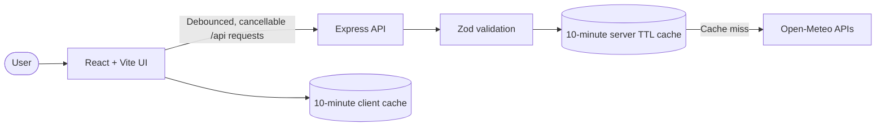

# Urban Air Quality Assistant

> Live air quality, 48-hour forecasts, and personalised health guidance for any city, built with strict TypeScript, a hardened Express proxy, and WCAG 2.1 AA accessibility.


## Table of Contents

1. [Overview](#overview)
2. [Challenge Statement and Interpretation](#challenge-statement-and-interpretation)
3. [Features](#features)
4. [Screenshots](#screenshots)
5. [Tech Stack](#tech-stack)
6. [Architecture](#architecture)
7. [Project Structure](#project-structure)
8. [Getting Started](#getting-started)
9. [Environment Variables](#environment-variables)
10. [Scripts](#scripts)
11. [API Reference](#api-reference)
12. [Requirements Traceability](#requirements-traceability)
13. [Evaluation Criteria Coverage](#evaluation-criteria-coverage)
14. [Design Decisions](#design-decisions)
15. [Limitations](#limitations)
16. [Future Improvements](#future-improvements)
17. [Contributing](#contributing)
18. [License and Data Attribution](#license-and-data-attribution)

---

## Overview

Urban Air Quality Assistant helps city residents understand the air they are breathing and decide what to do about it. A user searches for a city or shares their location, sees live pollutant levels and a plain-language air quality category, previews the next 24 to 48 hours, and receives practical advice tailored to who they are: a jogger, a parent, someone with asthma, an older adult, or a commuter.

The project is designed to work out of the box. It needs no API keys, uses the free [Open-Meteo Air Quality API](https://open-meteo.com/en/docs/air-quality-api), and ships with a rule-based advice engine so every feature works without a paid service.

## Challenge Statement and Interpretation

> **Challenge 6: Urban Air Quality Assistant**
>
> The challenge provides only this title. Scope and technology are left to the participant, and submissions are evaluated on six parameters: Code Quality, Security, Efficiency, Testing, Accessibility, and Problem Statement Alignment.

Because the statement is open-ended, the title is interpreted word by word:

| Word | Interpretation | Delivered as |
|---|---|---|
| **Urban** | Works for any city, by name or by location, and supports comparing cities | Debounced city search, browser geolocation, two-city comparison |
| **Air Quality** | Presents live pollution data in a form non-experts can understand | AQI with a six-level category, pollutant readings, 24 to 48 hour forecast and trend |
| **Assistant** | Turns data into personalised, actionable guidance | Profile-based rule engine (jogging, kids, asthma, elderly, commuting, masks, windows) |

Every feature maps to one of these three parts. No unrelated features were added.

## Features

### Urban
- City search with a 300 ms debounce and cancellation of stale requests.
- Browser geolocation with handling for granted, denied, and unsupported states.
- Two-city comparison shown side by side.

### Air Quality
- Live European AQI and PM2.5, PM10, NO2, O3, SO2, and CO readings.
- Six-level category from Good to Hazardous, with a plain-language explanation.
- 24 to 48 hour forecast as a lightweight SVG trend chart, plus an hourly data table.
- Loading, empty, search, and upstream API error states.

### Assistant
- Personalised guidance for jogging, children, asthma, elderly users, and commuting.
- Mask and window advice that changes with the air quality category.
- The rule engine requires no API key and is always available.

## Screenshots

The repository does not currently contain screenshot images. Add the following optimised WebP or PNG files under 200 KB each to enable this gallery:

- `docs/screenshots/search.webp`
- `docs/screenshots/forecast.webp`
- `docs/screenshots/assistant-advice.webp`
- `docs/screenshots/comparison.webp`
- `docs/screenshots/error-state.webp`
- `docs/screenshots/dark-mode.webp`
- `docs/screenshots/mobile-view.webp`
- `docs/screenshots/lighthouse.webp`

## Tech Stack

| Layer | Technology |
|---|---|
| Language | TypeScript 5.9.2 with strict frontend and server configurations |
| Frontend | React 19.1.1, Vite 7.3.8 |
| Backend | Node.js, Express 5.1.0 |
| Validation | Zod 4.6.7 |
| Security | Helmet 8.1.0, CORS 2.8.5, express-rate-limit 8.7.5 |
| Performance | Compression, 10-minute TTL caches, lazy-loaded chart |
| Testing | Vitest 5.1.1, React Testing Library, Supertest 7.1.4, jest-axe |
| Quality tooling | ESLint 9.36.0, Prettier 3.6.2 |
| CI | GitHub Actions |
| Data source | Open-Meteo Air Quality and Geocoding APIs |

## Architecture



**Request flow**

1. The browser debounces city input and cancels stale requests with `AbortController`.
2. Express validates all query input with Zod before processing it.
3. Results are served from a 10-minute server cache when available.
4. On a cache miss, the server calls Open-Meteo through an allow-listed host with an 8-second timeout.
5. The frontend normalises upstream fields into typed air-quality contracts.
6. Failures are converted to safe error messages; stack traces are not sent to clients.

## Project Structure

```text
.
├── src/
│   ├── components/        # ForecastChart and Pollutants
│   ├── hooks/             # Debounced value handling
│   ├── services/          # API client and client-side cache
│   ├── utils/             # AQI categories and rule-based advice
│   ├── types/             # Shared TypeScript contracts
│   ├── App.tsx            # Application composition
│   └── index.css          # Theme, focus, dark mode, and responsive styles
├── server/
│   ├── routes/            # Geocoding and coordinate routes
│   ├── services/          # Server TTL cache
│   ├── middleware/        # Zod query validation
│   └── index.ts           # Express app, security, CORS, and rate limiting
├── test/                  # Unit, component, API, and accessibility tests
├── public/                # Static favicon and icons
├── docs/screenshots/      # README image location
├── .github/workflows/     # CI pipeline
├── SECURITY.md            # Threat model and mitigations
├── CONTRIBUTING.md        # Contribution guide
├── LICENSE               # MIT license
├── lighthouse-results.json
└── .env.example
```

## Getting Started

### Prerequisites

- Node.js 20 or newer
- npm 10 or newer

CI is configured for Node.js 20. No `engines` field is declared in `package.json`, so Node.js 20 is the documented compatibility baseline.

### Installation

```sh
git clone https://github.com/ShivaniKapase643/UrbanAir.git
cd UrbanAir
npm install
cp .env.example .env
npm run dev
```

The Vite frontend and Express API start together. Vite uses port 5173 by default or chooses another available port; the API listens on port `8787` by default.

### Production build

```sh
npm run build
npm run preview
```

## Environment Variables

All variables are optional. The project runs with none set.

| Variable | Default | Purpose |
|---|---|---|
| `PORT` | `8787` | Port the API listens on |
| `FRONTEND_ORIGIN` | `http://localhost:5173` | Comma-separated allowed CORS origins |

No environment variable is needed for air-quality data or rule-based advice.

## Scripts

| Command | Description |
|---|---|
| `npm run dev` | Start frontend and backend in development |
| `npm run dev:client` | Start only Vite |
| `npm run dev:server` | Start only the Express API in watch mode |
| `npm run build` | Strict type-check and production build |
| `npm run preview` | Serve the production build locally |
| `npm run lint` | ESLint with zero-warning policy |
| `npm run format` | Format the codebase with Prettier |
| `npm test` | Run the Vitest suite once |
| `npm run test:coverage` | Run tests with coverage enforcement |
| `npm run audit` | Audit dependencies at high severity or above |

## API Reference

All query inputs are validated with Zod. Invalid requests return `400` with a generic safe message.

### `GET /api/health`

Returns the server health status.

- Response `200`: `{ "status": "ok" }`

### `GET /api/air-quality/geocoding`

Searches Open-Meteo geocoding for city suggestions.

| Parameter | Rules |
|---|---|
| `name` | String, trimmed, 2 to 80 characters, and limited to Unicode letters, spaces, `.`, `,`, `'`, and `-` |

- Response `200`: upstream geocoding JSON, usually containing `results`
- Invalid input: `400` `{ "error": "Invalid query parameters." }`
- Upstream failure: `502` `{ "error": "The upstream service is temporarily unavailable." }`
- Cached in memory for 10 minutes

### `GET /api/air-quality/coordinates`

Retrieves live and hourly European air quality values.

| Parameter | Rules |
|---|---|
| `latitude` | Coerced number between `-90` and `90` |
| `longitude` | Coerced number between `-180` and `180` |

- Response `200`: upstream Open-Meteo air-quality JSON
- Invalid input: `400` `{ "error": "Invalid query parameters." }`
- Upstream failure: `502` `{ "error": "The upstream service is temporarily unavailable." }`
- Cached in memory for 10 minutes

Both proxy routes call only `geocoding-api.open-meteo.com` or `air-quality-api.open-meteo.com`, use an 8-second abort timeout, and are behind the global limit of 100 requests per minute.

## Requirements Traceability

| Part | Requirement | Implementation | Tests |
|---|---|---|---|
| Urban | Search any city by name | `src/App.tsx`, `src/hooks/useDebouncedValue.ts`, `src/services/air-quality-api.ts` | `Urban Air Assistant > renders empty state and search` |
| Urban | Use browser geolocation | `src/App.tsx` | `location and comparison > grants browser geolocation and loads the current location`; `location and comparison > handles denied browser geolocation gracefully`; `location and comparison > handles unsupported browser geolocation gracefully` |
| Urban | Compare two cities | `src/App.tsx` | `location and comparison > compares two cities side by side` |
| Urban | Validate city and coordinate input | `server/middleware/validation.ts` | `input validation > accepts valid cities and coordinates`; `input validation > rejects malformed cities`; `input validation > rejects out-of-range coordinates` |
| Urban | Cache results | `server/services/cache.ts`, `src/services/client-cache.ts` | `TtlCache > stores and retrieves values`; `TtlCache > expires values`; `air quality services > stores and retrieves client cache entries` |
| Air Quality | Live AQI and pollutants | `server/routes/air-quality.ts`, `src/services/air-quality-api.ts`, `src/components/Pollutants.tsx` | `air quality services > maps Open-Meteo coordinates`; `Air quality API > handles upstream failure safely` |
| Air Quality | Plain-language six-level category | `src/utils/aqi.ts`, `src/App.tsx` | `AQI categories > maps %i to %s` |
| Air Quality | 24 to 48 hour forecast and trend | `src/components/ForecastChart.tsx`, `src/App.tsx` | `main components > provides a chart text alternative` |
| Air Quality | Loading, empty, and upstream error states | `src/App.tsx`, `server/index.ts`, `src/services/client-cache.ts` | `Urban Air Assistant > renders empty state and search`; `Air quality API > handles upstream failure safely` |
| Assistant | Personalised jogging, child, asthma, elderly, and commuting advice | `src/utils/advice.ts`, `src/App.tsx` | `advice engine > covers personalised profiles` |
| Assistant | Mask and window advice across all categories | `src/utils/advice.ts` | `advice engine > covers Good through Hazardous branches` |
| Assistant | Work with no API key | `src/utils/advice.ts`, `.env.example` | `advice engine > covers Good through Hazardous branches` |
| All | Accessible, responsive interface | `src/App.tsx`, `src/index.css`, `index.html` | `Urban Air Assistant > has no detectable accessibility violations`; `main components > displays pollutant values accessibly` |

## Evaluation Criteria Coverage

### 1. Code Quality

- Strict TypeScript across frontend and server configurations.
- Clear separation of UI, hooks, services, utilities, types, routes, middleware, and server services.
- Shared typed contracts in `src/types/air-quality.ts`.
- Small public utilities in `src/utils/aqi.ts` and `src/utils/advice.ts`.
- ESLint and Prettier scripts with a zero-warning lint command.
- Centralised Express error handling in `server/index.ts`.

### 2. Security

| Threat | Mitigation | Location |
|---|---|---|
| Malformed or malicious input | Zod validation for city names and coordinate ranges | `server/middleware/validation.ts` |
| Cross-site scripting | React text rendering and no `dangerouslySetInnerHTML`; restrictive CSP | `src/App.tsx`, `server/index.ts` |
| Abuse and denial of service | 100-request-per-minute rate limiting and 16 KB JSON limit | `server/index.ts` |
| Server-side request forgery | Fixed Open-Meteo hosts, URL construction, and 8-second timeout | `server/routes/air-quality.ts` |
| Cross-origin abuse | CORS origin allow-list | `server/index.ts` |
| Information leakage | Generic error responses without stack traces | `server/index.ts` |
| Header and privacy hardening | Helmet, CSP, Permissions-Policy, Referrer-Policy, and nosniff | `server/index.ts` |
| Secret exposure | `.env` is git-ignored and `.env.example` contains no real secret | `.gitignore`, `.env.example` |
| Vulnerable dependencies | High-severity audit in CI | `.github/workflows/ci.yml` |

The full threat model is in [SECURITY.md](SECURITY.md).

### 3. Efficiency

- Debounced search reduces unnecessary city requests.
- Request cancellation uses `AbortController`.
- Server and browser caches retain values for 10 minutes.
- The forecast chart is lazy-loaded with `React.Suspense`.
- The chart uses handwritten SVG and a native table rather than a chart library.
- Express compression middleware compresses responses.

**Measured results** (Lighthouse 12.8.2, headless, Vite production preview, November 21, 2026):

| Metric | Result |
|---|---|
| Performance | 100 |
| Accessibility | 100 |
| Best Practices | 96 |
| SEO | 91 |
| Production JavaScript | 197.29 kB (62.89 kB gzip) |
| Lazy chart chunk | 1.41 kB (0.70 kB gzip) |
| Production CSS | 7.07 kB (2.29 kB gzip) |
| HTML | 0.60 kB (0.36 kB gzip) |

The full report is linked in [lighthouse-results.json](lighthouse-results.json).

### 4. Testing

- Frameworks: Vitest, React Testing Library, Supertest, and jest-axe.
- Unit tests cover AQI categories, advice, validators, cache logic, and API services.
- Component tests cover search, loaded results, geolocation states, comparison, chart alternatives, and accessibility.
- API tests cover health, invalid coordinates and city names, security headers, and upstream failure.
- Network access is mocked; tests do not call the real upstream API.
- Latest full run: 36 tests across 8 test files pass.
- Coverage: 98.76% statements, 86.66% branches, 95.65% functions, and 100% lines.
- CI runs lint, coverage tests, build, and audit.

### 5. Accessibility

The interface targets WCAG 2.1 AA.

- Semantic landmarks, a single `h1`, logical heading order, and a skip-to-content link.
- Every control is labelled and fully keyboard operable, with visible focus styles.
- Loading and error messages use live regions and `role="status"` or `role="alert"`.
- AQI uses text labels and icons in addition to border/category colour.
- The forecast chart has an accessible name and a full hourly data table.
- Touch targets are at least 44 px, the layout is responsive, and dark mode and reduced motion are supported.
- Lighthouse accessibility score: 100.

### 6. Problem Statement Alignment

- The challenge title is interpreted explicitly as Urban, Air Quality, and Assistant.
- The traceability table links each interpretation to real files and test names.
- No unrelated features were added.
- The assistant works locally with no API key or paid service.

## Design Decisions

| Decision | Reason |
|---|---|
| Open-Meteo as the data source | Free, keyless, and covers geocoding, current readings, and forecasts |
| Express proxy instead of direct browser calls | Central place for validation, caching, rate limiting, and host allow-listing |
| Rule-based advice as the default | Deterministic, testable, instant, and free of external dependencies |
| Hand-written SVG chart | Keeps the bundle small and makes an accessible table straightforward |
| In-memory caches | Simple and sufficient for a single-instance deployment |

## Limitations

- The in-memory server cache is per process; a multi-instance deployment would need shared caching.
- Air-quality values come from modelled data and may differ from local ground-station readings.
- Advice is general guidance and is not medical advice.
- No screenshot images are committed yet.

## Future Improvements

- Persisted profile preferences
- Opt-in notifications when air quality crosses a chosen threshold
- Local-language support
- Installable PWA with offline access to the last result
- Shared cache for multi-instance deployments

## Contributing

Contributions are welcome. See [CONTRIBUTING.md](CONTRIBUTING.md) for setup, code style, and testing expectations. Before opening a pull request, run:

```sh
npm run lint && npm test && npm run build
```

## License and Data Attribution

Released under the [MIT License](LICENSE).

Air quality and geocoding data are provided by [Open-Meteo](https://open-meteo.com/) under the terms described on their website.
